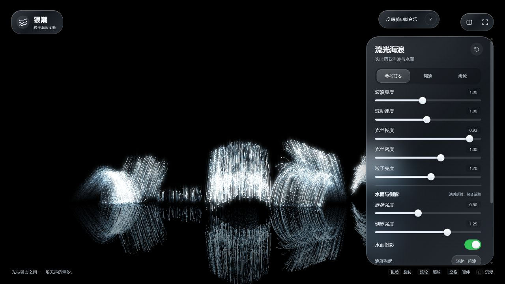
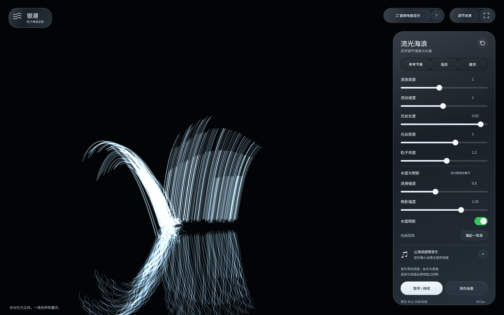

# 银潮 · 流光海浪

银白光丝组成的实时海浪：包含涟漪、倒影、回落与弹起效果，以及 Apple 风格的玻璃控制面板。同时提供独立网页版、原生 Rive 重制版与完整源项目。



## 快速运行网页版

需要 Node.js 18 或更新版本，无需安装第三方依赖。

```sh
node scripts/serve.cjs
```

打开终端显示的 `http://127.0.0.1:4173/`。

已安装 npm 时也可以用 `npm run dev`。如果端口被占用，在 PowerShell 中指定另一个端口：

```powershell
$env:PORT = '4187'
node scripts/serve.cjs
```

也可使用 Python：

```sh
python -m http.server 4173 --directory web
```

独立单文件版本在 [downloads/silver-tide-standalone.html](downloads/silver-tide-standalone.html)。系统声音采集建议通过 localhost 或 HTTPS 页面，在 Windows 的 Chrome / Edge 中使用。

## 跟随音乐

1. 让音乐软件播放音乐。
2. 点击「跟随电脑音乐」。
3. 在浏览器弹窗选择整个屏幕并启用「共享系统音频」；网页音乐也可共享对应标签页的音频。

音乐影响 **流动速度、光丝长度和密度**。波浪高度与粒子亮度保持手动控制。声音在本机分析，不上传服务器。也可以用面板中的「＋」载入本地音频。

拖动画面旋转视角，滚轮缩放；`H` 收起/显示面板，空格暂停/继续，`F` 切换全屏。

## Rive 动画

- [下载 silver-tide.riv](downloads/silver-tide.riv)：1600 × 1000，8 秒循环，包含海浪与玻璃面板。
- [Rive 源项目](rive/)：RML、配置、嵌入字体及数据模型说明。
- [源项目压缩包](downloads/silver-tide-rive-source.zip)。

这是 **Rive 原生重制版**，不是 HTML/WebGL 的无损转换。玻璃与倒影采用近似效果，不包含网页版的实时随机物理或三维视角拖动。滑块、预设、暂停、倒影开关等在 Rive 文件内处理；音乐采集、音频文件选择、截图、全屏和额外喷溅事件需宿主程序接入。

画板：`Silver Tide`；状态机：`Ocean Controls`；数据模型：`OceanControls`。详细参数与宿主事件见 [Rive 使用说明](rive/使用说明.md)。



安装 [Rive 官方 CLI](https://rive.app/docs/cli/overview) 后可检查、预览和重新导出：

```sh
rive rive --verify
rive rive
rive rive --once
```

输出为 `rive/build/silver-tide.riv`。`.riv` 是运行时格式；导出编辑器 `.rev` 需要在自己的 Rive 账号登录后运行 `rive rive --once --rev=silver-tide.rev`。

`npm run generate:rive` 会根据当前海浪轨迹重新生成 `rive/scene.rml`，覆盖手动修改的 RML。已有字体子集可直接使用；增加界面文字时请更新字体的相应字形。

## 项目结构

```text
web/          WebGL 网页与全部运行时资源
rive/         原生 Rive 源项目、字体及使用说明
downloads/    .riv、独立 HTML 与 Rive 源项目压缩包
docs/         网页和 Rive 的真实渲染预览
scripts/      本地静态服务器、Rive 生成器与字体更新脚本
tests/        粒子物理、音频采集与音乐响应检查
```

```sh
npm test
```

字体为 Noto Sans SC 子集，许可证见 [OFL.txt](rive/assets/OFL.txt)。
